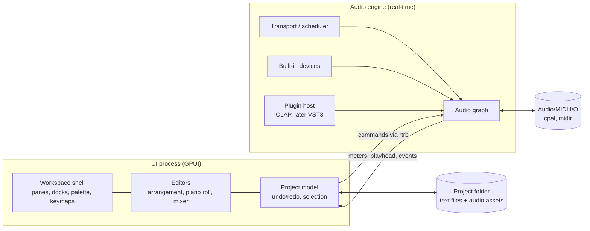

# IDE-Shaped DAW: Concept Outline

## Vision
A music production DAW laid out like a modern code editor: docked panels, tabbed editors, a command palette, keyboard-driven workflow, and project files that work with version control. Music is made through dedicated visual editors (piano roll, arrangement, mixer). There's no coding involved in producing music.

## Core principles
- **Keyboard-first, mouse-complete.** Every action is a named command, searchable in the palette and rebindable. Every action is also reachable with the mouse.
- **Editors as tabs.** Clips, patterns, tracks and devices open as tabs that can be split, docked and rearranged like files in an IDE.
- **Context-aware shortcuts.** The same key does different things depending on focus: piano roll, arrangement or mixer.
- **Project as a workspace.** A song is a folder of human-readable files that diff and merge cleanly in git.
- **Real-time safety.** The audio engine never waits on the UI.

## Workspace layout

| Region | Contents |
|---|---|
| **Activity bar** | Switches the sidebar between Browser, Tracks, Devices, Search and Version Control |
| **Sidebar** | Sample/preset browser, track list, device library, project search, git changes |
| **Editor area** | Tabbed, splittable: Arrangement, Piano Roll, Audio Clip Editor, Automation, Device Chain |
| **Bottom panel** | Mixer, MIDI monitor, engine log/CPU, render queue |
| **Status bar** | Transport, tempo, time signature, sample rate, buffer size, CPU/DSP load, git branch |
| **Command palette** | Fuzzy search over every command, track, device and file |
| **Inspector** | Properties of the current selection (clip, note, device, track) |

## Editors
- **Arrangement:** tracks and clips on a timeline, with markers, loop regions and tempo/time-signature lanes.
- **Piano roll:** notes, velocity and CC lanes, scale highlighting, quantize, multi-clip editing.
- **Audio clip editor:** waveform view, warping/stretching, fades, gain and transient markers.
- **Automation:** per-parameter lanes, curve editing, recording modes.
- **Mixer:** channel strips, sends, buses, meters, plugin slots.
- **Device chain:** each track's instruments and effects in order, with built-in device panels.

## Architecture



- **UI thread:** owns the project model, undo/redo, selection and rendering.
- **Audio thread:** owns a compiled snapshot of the graph. It receives commands through lock-free queues and sends back meters, playhead position and events.
- **Graph updates:** the UI builds a new graph off the audio thread and swaps it in atomically. Old graphs are freed off-thread.
- **Plugins:** hosted in the engine process at first. Out-of-process sandboxing can come later for crash isolation.

## Technology stack (Rust)

| Area | Choice |
|---|---|
| UI framework | **GPUI**, used standalone (Apache-2.0), with Zed's workspace and pane patterns as reference |
| Audio I/O | **`cpal`** |
| MIDI I/O | **`midir`** |
| Audio graph | Custom, or **Firewheel** |
| UI↔engine messaging | **`rtrb`** lock-free ring buffers |
| Real-time safety | **`assert_no_alloc`** in dev builds, **`basedrop`** for deferred frees |
| File decoding | **`symphonia`** |
| Resampling | **`rubato`** |
| DSP building blocks | **`fundsp`** |
| Built-in instruments/effects | **`nih-plug`** |
| Plugin hosting | **`clack`** (CLAP) first; VST3/AU later |
| Project serialization | `serde` with a text format (RON, TOML or JSON) |

## Real-time rules for the audio thread
- No allocation, locks, file or network I/O, or logging.
- All communication goes through preallocated lock-free queues.
- Parameters change through atomics or smoothed values.
- Graph and buffer memory is preallocated before it's handed to the engine.

## Project format
```
my-song/
  song.ron            # tempo, time signature, track order, markers
  tracks/
    01-drums.ron      # devices, routing, automation
    02-bass.ron
  clips/
    bass-intro.ron    # MIDI notes, clip properties
  audio/
    kick.wav
  .gitignore          # renders, caches, waveform peaks
```
- One file per track and per clip keeps git diffs small and merges workable.
- Waveform peak caches and renders are generated and git-ignored.

## MVP scope
1. Workspace shell: activity bar, sidebar, tabbed and split editor area, bottom panel, status bar, command palette, configurable keybindings
2. Audio engine: `cpal` output, transport, tempo, sample-accurate MIDI scheduling
3. One built-in synth and a few effects (gain, EQ, delay) using `nih-plug` and `fundsp`
4. Arrangement view with MIDI clips
5. Piano roll
6. Basic mixer: volume, pan, mute/solo, meters
7. Save and load in the text project format
8. Offline render to WAV

## Later phases
- **Audio:** recording, audio clips, warping, fades
- **Automation:** lanes and recording modes
- **Plugins:** CLAP hosting via `clack`, plugin GUI windows, plugin scanning
- **Routing:** buses, sends, sidechain
- **Version control:** git panel (changes, commit, branch, compare versions)
- **Extensibility:** an extension API for custom commands, panels and devices
- **More formats:** VST3/AU hosting, out-of-process plugin sandboxing

## Risks

| Risk | Mitigation |
|---|---|
| GPUI has sparse docs and changing APIs | Pin a version; read Zed's source; keep UI code behind your own component layer |
| Plugin GUI embedding (native windows) | Start with floating plugin windows; embed per platform later |
| VST3/AU hosting maturity in Rust | Ship CLAP first; add VST3 once the core is stable |
| Real-time glitches | Enforce `assert_no_alloc` in CI, stress-test with small buffers, keep audio-thread code minimal |
| Large scope | Hold the MVP to MIDI-only production before adding audio recording |
| Plugin crashes taking down the app | Move plugins out of process in a later phase |

## Prior art
- **Zed:** workspace, pane, dock and keymap patterns built on GPUI
- **Meadowlark:** an inactive open-source Rust DAW; useful engine and architecture docs
- **Firewheel:** an audio graph engine from Meadowlark's author
- **vizia:** Rust UI framework used for plugin GUIs
- **Bitwig, Ableton Live, Reaper, Renoise:** reference DAW workflows and UX

## Open questions
- Does the app need multiple windows from the start, or is one window with docks enough at first?
- Which serialization format: RON, TOML or JSON?
- Should the extension system use WASM plugins (sandboxed) or native Rust plugins?
- Which platforms to support first: macOS only, or macOS, Windows and Linux?
- Should version control be built in, or should the project just stay git-friendly so external tools can handle it?
